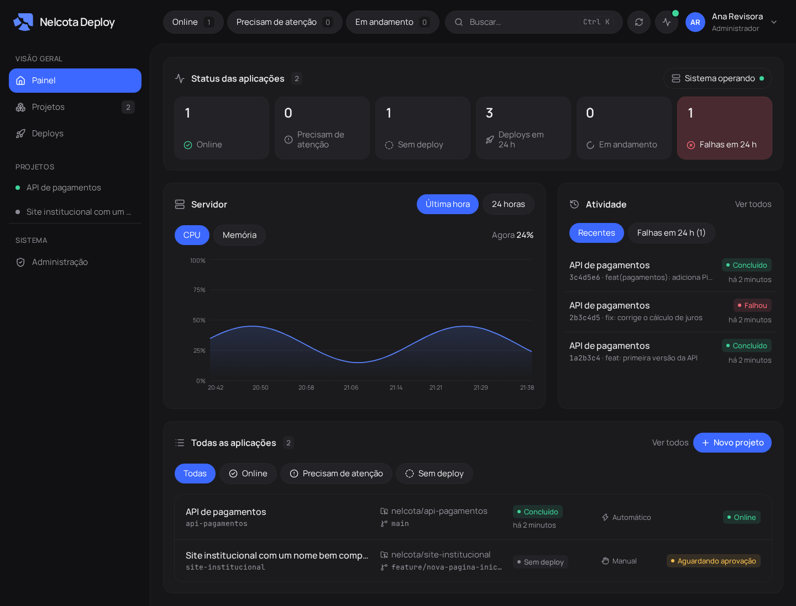
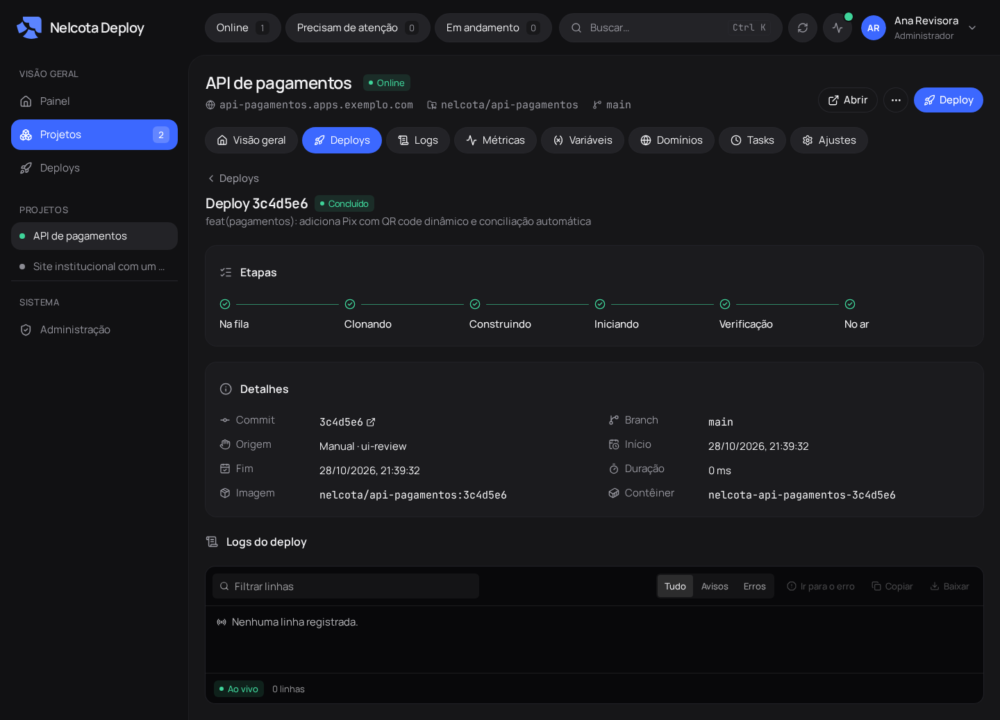
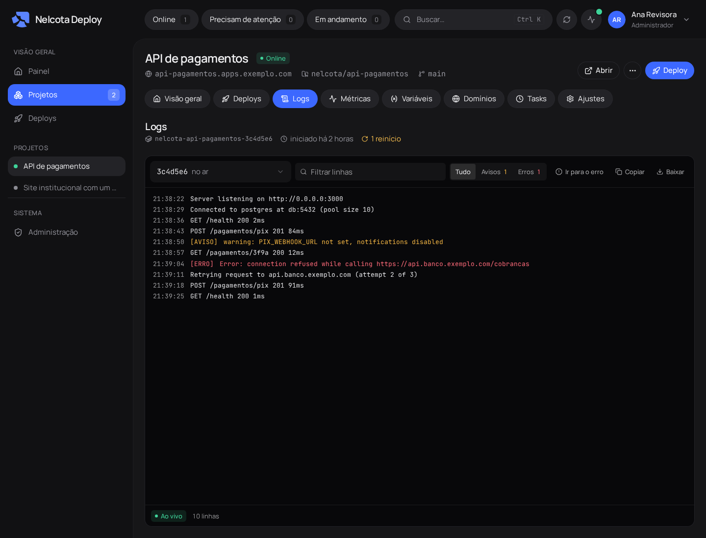

<div align="center">

<picture>
  <source media="(prefers-color-scheme: dark)" srcset="public/nelcota-logo-white.svg" />
  
</picture>

<h3>Nelcota Deploy</h3>

<p>Self-hosted deploy panel for a single Linux VPS with Docker.<br />
Push to GitHub, get a running container with logs, metrics and HTTPS.</p>

<p>
  <a href="https://github.com/Nelcota/NelcotaDeploy/actions/workflows/check.yml"></a>
  
  
  
</p>



</div>

## Why

In the spirit of Railway, Coolify and Dokploy, but small and shaped for one
organization. One Bun process serves the panel, another runs the builds; both share a SQLite
file. No Kubernetes, no external database, no agents to install.

## Features

| Area        | What it does                                                                                                         |
| ----------- | -------------------------------------------------------------------------------------------------------------------- |
| **Deploys** | Build the exact commit from GitHub, on push or by hand. Health check before switching, rollback, redeploy and retry. |
| **Logs**    | Live build and runtime logs with search, level filter and jump to the first error.                                   |
| **Metrics** | CPU and memory per container and for the host, with history.                                                         |
| **Config**  | Variables and secrets (AES-256-GCM), with a warning when saved changes are not live yet.                             |
| **Domains** | Automatic and custom domains, HTTPS by Let's Encrypt through Traefik.                                                |
| **Tasks**   | Commands that run inside the app container, on demand or on a cron schedule.                                         |
| **Team**    | Admin, developer and viewer roles, API tokens, an MCP server for AI clients and an audit log.                        |

<table>
  <tr>
    <td></td>
    <td></td>
  </tr>
</table>

## Quick start

Requires Linux with [Bun](https://bun.sh) 1.4+, git and Docker 23+.

```bash
bun install
bun run setup                                  # writes .env with generated secrets
bun run admin:create --email you@example.com   # first admin; prints the password once
bun run dev                                    # panel on http://localhost:3000
bun run worker                                 # in another terminal: builds, tasks, metrics
```

## Production

Docker Compose starts Traefik, the panel and the worker. Only the worker can reach the Docker socket.

```bash
bun run setup        # then set PUBLIC_URL, PANEL_DOMAIN and ACME_EMAIL in .env
echo "DOCKER_GID=$(stat -c %g /var/run/docker.sock)" >> .env
docker compose up -d --build
docker compose exec web bun run admin:create --email you@example.com
```

## Development

```bash
bun run check        # format, lint, types, unused code and tests
bun run ui:review    # screenshots of every screen plus an accessibility report
```

Built with Bun, TanStack Start, React, Tailwind, Drizzle, Better Auth and Traefik.

The full guide (architecture, GitHub webhook, MCP, backup, troubleshooting) is in
[docs/guia.md](docs/guia.md), in Portuguese.
