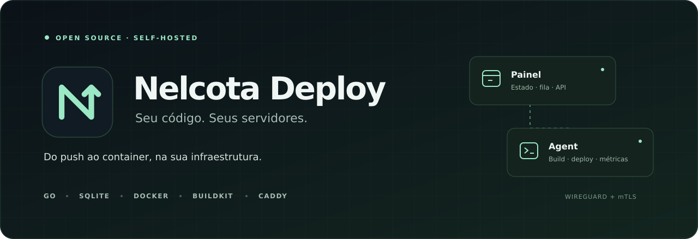
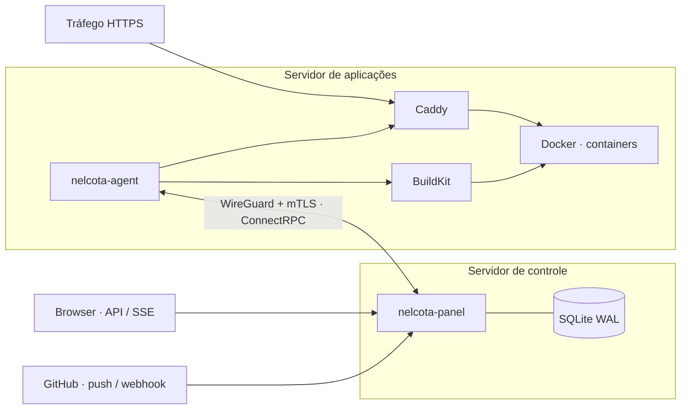

<p align="center">
  
</p>

<p align="center">
  <a href="https://github.com/Nelcota/nelcota-deploy/actions/workflows/ci.yml"></a>
  <a href="https://go.dev/dl/"></a>
  <a href="LICENSE"></a>
  
</p>

<p align="center">
  Plataforma de deploy <strong>open source e self-hosted</strong> em Go.<br>
  Do push no GitHub ao container em execução, com controle na sua infraestrutura.
</p>

<p align="center">
  <a href="#começar-localmente">Começar</a> ·
  <a href="docs/README.md">Documentação</a> ·
  <a href="docs/contrato-frontend.md">API</a> ·
  <a href="CONTRIBUTING.md">Contribuir</a> ·
  <a href="SECURITY.md">Segurança</a>
</p>

## O projeto

O Nelcota Deploy separa o controle das aplicações em dois componentes: um painel mantém o estado desejado e a fila de deploys; um agent constrói imagens, executa containers e atualiza o roteamento. A comunicação acontece por ConnectRPC com mTLS dentro da rede WireGuard.

SQLite, dois binários Go e serviços conhecidos: Docker, BuildKit e Caddy. A v1 exige um **Dockerfile no repositório da aplicação**.

> [!IMPORTANT]
> **Backend implementado; interface em construção.** A página web atual é um placeholder. Há testes locais com Docker/BuildKit/Caddy reais, mas a instalação completa e as metas de operação ainda precisam de homologação em VPS. Consulte o [estado das entregas](docs/relatorio-backend.md) e as [pendências](docs/pendencias.md) antes de usar em produção.

## O que já está implementado

| Área | Recursos |
| --- | --- |
| Deploy | Git por SHA exato, fila transacional, coalescing, build com cache, healthcheck, troca de rota e cancelamento |
| Execução | Containers sem root, limites de recursos, filesystem somente leitura e rede por aplicação |
| Acesso | Passkeys, TOTP, recovery codes, convites, sessões e tokens com escopos |
| Comunicação | mTLS, assinatura de comandos, proteção contra replay e reconexão do agent |
| Observabilidade | Logs de build e runtime via SSE, retenção zstd, métricas de host e containers |
| Operação | Backup criptografado local/S3, restore offline, atualização assinada e rollback do executável |

## Como funciona



O agent inicia a conexão com o painel. O protocolo tem uma lista fechada de ações; não oferece shell remoto. O Caddy recebe o tráfego público das aplicações e troca o upstream depois da verificação de saúde.

## Começar localmente

**Requisitos:** Linux, Go **1.26.9+**, Git, Make, `protoc` e ShellCheck. Docker e Caddy são necessários para os testes de integração; o modo de desenvolvimento usa agents simulados.

```bash
git clone https://github.com/Nelcota/nelcota-deploy.git
cd nelcota-deploy

make tools
make generate
make build test lint
make dev-seed
make dev
```

Abra **http://127.0.0.1:8080**. Os dados de exemplo ficam em `.local/dev`, fora do Git. A interface ainda mostra uma página inicial simples; as APIs e os streams já estão disponíveis.

<details>
<summary><strong>Usar a API com uma sessão de desenvolvimento</strong></summary>

Com o processo de desenvolvimento ativo:

```bash
curl -c /tmp/nelcota-dev-cookies \
  -H 'Origin: http://127.0.0.1:8080' \
  -H 'Content-Type: application/json' \
  -d '{}' http://127.0.0.1:8080/api/dev/session

curl -b /tmp/nelcota-dev-cookies \
  http://127.0.0.1:8080/api/session

curl -b /tmp/nelcota-dev-cookies \
  http://127.0.0.1:8080/api/apps
```

`GET /api/session` informa o token CSRF para as próximas mutações. O endpoint de login dev só existe nesse modo. O processo escuta apenas no loopback e deve permanecer local.

</details>

## Desenvolvimento e verificações

| Comando | Finalidade |
| --- | --- |
| `make build` | Compilar painel e agent em `bin/` |
| `make test` | Executar a suíte de testes |
| `make lint` | Conferir formatação, vet, golangci-lint e ShellCheck |
| `make check-generated` | Verificar geração reproduzível de Protobuf/Connect/sqlc |
| `CGO_ENABLED=1 go test -race -count=1 ./...` | Verificar concorrência com race detector; requer compilador C |
| `make test-integration` | Exercitar Docker, BuildKit, Caddy e instaladores |
| `make bench` | Medir benchmarks locais |

Os testes de integração falham quando a infraestrutura necessária não está disponível. O [CI](https://github.com/Nelcota/nelcota-deploy/actions) executa as verificações automaticamente em pushes e pull requests.

## Documentação

- [Índice e caminhos de leitura](docs/README.md)
- [Contrato de APIs e integração do frontend](docs/contrato-frontend.md)
- [Instalação e homologação em duas VPS](docs/testar-em-vps.md)
- [Operação: backup, restore, updates e recuperação](docs/operacao-backend.md)
- [Estado do backend e evidências de validação](docs/relatorio-backend.md)
- [Releases locais de homologação](docs/releases-homologacao.md)
- [Decisões técnicas](docs/decisoes.md)

Os pacotes de homologação descritos na documentação são artefatos locais, ignorados pelo Git. Uma publicação oficial de binários terá seus próprios releases e instruções verificáveis.

## Próximas etapas

- [ ] Interface com templ, Datastar e Tailwind.
- [ ] Homologação de instalação, firewall, WireGuard, reboot e recuperação em VPS.
- [ ] Validação de GitHub App, passkeys e armazenamento S3 em ambientes reais.
- [ ] Metas de desempenho comprovadas em infraestrutura representativa.
- [ ] Distribuição oficial de releases assinados.

Previews por pull request, notificações, scale-to-zero, Trivy e Litestream estão previstos para a fase 2. O [plano original](docs/Nelcota%20Deploy.md) registra a visão; o [relatório](docs/relatorio-backend.md) registra o que foi efetivamente entregue.

## Contribuir

Leia o [guia de contribuição](CONTRIBUTING.md) para preparar o ambiente e abrir uma proposta. Bugs e sugestões podem ser registrados nas [issues](https://github.com/Nelcota/nelcota-deploy/issues). Relatos de vulnerabilidade devem seguir a [política de segurança](SECURITY.md).

## Licença

[MIT](LICENSE) · Copyright © 2026 Haniel Fialho e contribuidores do Nelcota Deploy.
