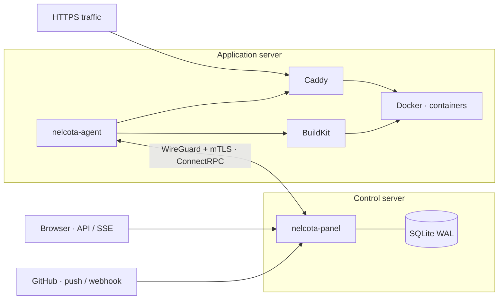

<p align="center">
  
</p>

<p align="center">
  <a href="https://github.com/Nelcota/NelcotaDeploy/actions/workflows/ci.yml"></a>
  <a href="https://go.dev/dl/"></a>
  <a href="LICENSE"></a>
  
</p>

<p align="center">
  An <strong>open-source, self-hosted</strong> deployment platform built with Go.<br>
  From a GitHub push to a running container, on infrastructure you control.
</p>

<p align="center">
  <a href="#local-development">Get started</a> ·
  <a href="docs/README.md">Documentation</a> ·
  <a href="docs/frontend-contract.md">API</a> ·
  <a href="CONTRIBUTING.md">Contribute</a> ·
  <a href="SECURITY.md">Security</a>
</p>

## Overview

NelcotaDeploy separates application control into two components: a panel stores desired state and schedules deployments; an agent builds images, runs containers, and updates routing. They communicate through ConnectRPC with mTLS over a WireGuard network.

SQLite, two Go binaries, and familiar services: Docker, BuildKit, and Caddy. The initial version requires a **Dockerfile in your application repository**.

> [!IMPORTANT]
> **Not production-ready.** The backend and web interface are implemented and tested locally, including real Docker, BuildKit, and Caddy. Installation on real servers, real passkey devices, and performance targets still need VPS acceptance. See [status](docs/status.md).

## Implemented capabilities

| Area | Capabilities |
| --- | --- |
| Deployment | Exact Git SHA, transactional queue, coalescing, cached builds, healthchecks, route switching, and cancellation |
| Runtime | Non-root containers, resource limits, read-only filesystems, and per-application networks |
| Access | Passkeys, TOTP, recovery codes, invitations, sessions, and scoped API tokens |
| Communication | mTLS, signed commands, replay protection, and agent reconnection |
| Observability | Build and runtime logs over SSE, zstd retention, host and container metrics |
| Operations | Encrypted local/S3 backups with weekly test restores, offline restore, signed updates with automatic checks, and executable rollback |
| Notifications | Webhooks (Slack, Discord, signed JSON) and email for failed deployments, offline servers, full disks, backups, and updates |
| Interface | Server-rendered panel (templ, Datastar, Tailwind, Basecoat) with live status, xterm.js logs, uPlot metrics, light/dark themes, English and Brazilian Portuguese, and a command palette |

## Architecture



The agent initiates its connection to the panel. The protocol exposes a fixed set of actions and no remote shell. Caddy receives public application traffic and switches upstreams after the new deployment passes its healthcheck.

## Local development

**Requirements:** Linux, Go **1.26.9+**, Git, Make, **protoc 36.1**, and ShellCheck. Docker and Caddy are required for integration tests; development mode uses simulated agents. CI pins and verifies the protoc archive to keep generated files reproducible.

```bash
git clone https://github.com/Nelcota/NelcotaDeploy.git
cd NelcotaDeploy

make tools
make generate
make build test lint
make dev-seed
make dev
```

Open **http://127.0.0.1:8080** and choose **Continue as development administrator**. Sample data lives in `.local/dev`, outside Git. Browsers do not accept IP addresses for passkeys; to try real passkeys, run with `NELCOTA_DEV_ORIGIN=http://localhost:8080`.

<details>
<summary><strong>Use the API with a development session</strong></summary>

With development mode running:

```bash
curl -c /tmp/nelcota-dev-cookies \
  -H 'Origin: http://127.0.0.1:8080' \
  -H 'Content-Type: application/json' \
  -d '{}' http://127.0.0.1:8080/api/dev/session

curl -b /tmp/nelcota-dev-cookies \
  http://127.0.0.1:8080/api/session

curl -b /tmp/nelcota-dev-cookies \
  http://127.0.0.1:8080/api/apps
```

`GET /api/session` returns the CSRF token required for subsequent mutations. The development login endpoint only exists in this mode. The process listens on loopback and must stay local.

</details>

## Development checks

| Command | Purpose |
| --- | --- |
| `make build` | Build the panel and agent into `bin/` |
| `make test` | Run the test suite |
| `make lint` | Check formatting, vet, golangci-lint, and ShellCheck |
| `make check-generated` | Check reproducible Protobuf/Connect/sqlc and web asset generation |
| `make web` | Generate templ components, Tailwind CSS, and fingerprinted precompressed assets |
| `make e2e` | Run Playwright browser tests (Node and `npx playwright install chromium` in `web/`) |
| `CGO_ENABLED=1 go test -race -count=1 ./...` | Run the race detector; requires a C compiler |
| `make test-integration` | Exercise Docker, BuildKit, Caddy, and installers |
| `make bench` | Run local benchmarks |

Integration tests fail when required infrastructure is missing. [CI](https://github.com/Nelcota/NelcotaDeploy/actions) runs the checks on pushes and pull requests.

## Documentation

- [Documentation index](docs/README.md)
- [Status: what is verified and what is open](docs/status.md)
- [Installation and acceptance testing on two VPS instances](docs/vps-testing.md)
- [Operations: backups, restore, updates, recovery, and notifications](docs/operations.md)
- [Service and API contract](docs/frontend-contract.md)
- [Development and release automation](docs/development.md)
- [Technical decisions](docs/decisions.md)

## Roadmap

- [x] Build the web interface with templ, Datastar, and Tailwind.
- [ ] Validate the interface with real passkeys, browsers, and devices against a VPS panel.
- [ ] Validate installation, firewall, WireGuard, reboot, and recovery on VPS infrastructure.
- [ ] Validate GitHub App integration, passkeys, and S3 storage in real environments.
- [ ] Prove performance targets on representative infrastructure.
- [ ] Publish official signed releases.

Pull request previews, scale-to-zero, Trivy, and Litestream are planned for a later phase. The [system plan](docs/system-plan.md) describes the original design.

## Contributing

Read the [contributing guide](CONTRIBUTING.md) to prepare your environment and submit a proposal. Report bugs and suggestions through [issues](https://github.com/Nelcota/NelcotaDeploy/issues). Follow the [security policy](SECURITY.md) for vulnerability reports.

All project content, commit messages, and pull requests must be written in **English**, as required by [AGENTS.md](AGENTS.md).

## License

[MIT](LICENSE) · Copyright © 2026 Haniel Fialho and NelcotaDeploy contributors.
