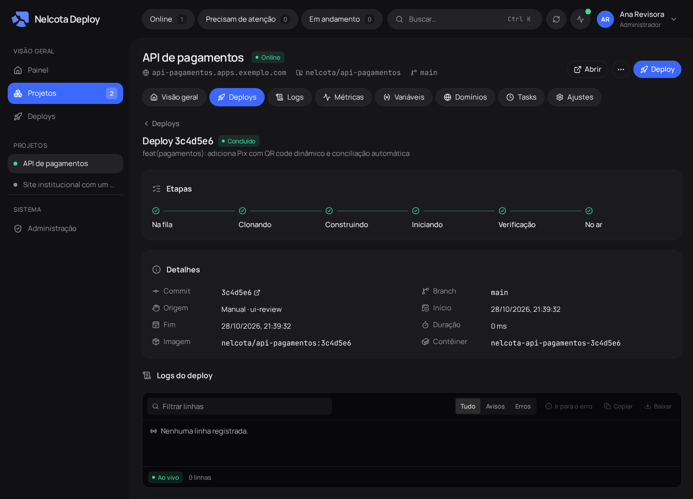

<div align="center">

<picture>
  <source media="(prefers-color-scheme: dark)" srcset="public/nelcota-logo-white.svg" />
  
</picture>

<h3>Nelcota Deploy</h3>

<p>Self-hosted deploy panel for Linux VPSs with Docker: one server or many over SSH.<br />
Push to GitHub, get a running container with logs, metrics and HTTPS.</p>

<p>
  <a href="https://github.com/Nelcota/NelcotaDeploy/actions/workflows/check.yml"></a>
  
  
  
</p>


</div>

## Why

In the spirit of Railway, Coolify and Dokploy, but small and shaped for one
organization. One Bun process serves the panel, another runs the builds; both share a SQLite
file. No Kubernetes, no external database, no agents to install.

## Features

| Area          | What it does                                                                                                                                                                  |
| ------------- | ----------------------------------------------------------------------------------------------------------------------------------------------------------------------------- |
| **Deploys**   | Build the exact commit from GitHub, on push or by hand. Zero-downtime switch after a health check, rollback and retry.                                                        |
| **GitHub**    | Search connected repositories; detect default branches, Dockerfiles and directories from a selection or pasted URL. Private access uses the GitHub App or a saved read token. |
| **Logs**      | Live build and runtime logs with search, level filter and jump to the first error.                                                                                            |
| **Metrics**   | CPU and memory per container and for the host, with history.                                                                                                                  |
| **Config**    | Detect `.env.example` variables, fill application URLs and generate local signing secrets. Preserve existing values; review atomic, encrypted imports before applying.        |
| **Previews**  | Each pull request to the project's branch gets its own temporary address; forks never run.                                                                                    |
| **Volumes**   | Detect final-stage Dockerfile VOLUME paths, excluding existing mounts and overlaps. Review additions and mount changes; data deletion stays explicit.                         |
| **Domains**   | Paste a complete URL to fill its domain and HTTP scheme. HTTPS through Traefik, live DNS checks and reviewed Cloudflare DNS configuration.                                    |
| **Ops**       | Daily database backups, encrypted off-site copies to any S3 bucket, and Discord or Slack alerts.                                                                              |
| **Servers**   | Paste an SSH address or simple command to fill host, port, account and an available name. Applications run over SSH; moves keep sites up.                                     |
| **Databases** | Detect missing PostgreSQL and Redis connection variables from `.env.example`, suggest unused names, then review the server before creating an encrypted connection.           |
| **Tasks**     | Discover package.json scripts, fill names and commands, then confirm execution or scheduling. Queued runs keep their original command and timeout.                            |
| **Team**      | Admin, developer and viewer roles, API tokens, an MCP server for AI clients and an audit log.                                                                                 |

<table>
  <tr>
    <td></td>
    <td></td>
  </tr>
</table>

## Quick start

Requires Linux with [Bun](https://bun.sh) 1.4+, git and Docker 23+.

Use a current browser with `Uint8Array.prototype.toBase64` support for avatar uploads and generated passwords.

Avatar uploads accept PNG, JPEG, and WebP up to 512 KiB and 1,048,576 total pixels. The server uses `Bun.Image` to decode every pixel with an explicit allocation limit, then stores a fresh encoding in the source format. The encoded output must also fit the 512 KiB limit.

Managed tasks and database commands require `sh` and Linux procfs inside the application
image. The supervisor uses them to stop commands and their descendants on timeout or cancellation;
command arguments are passed literally, without shell evaluation.

```bash
bun install
bun run setup    # writes .env with generated secrets
bun run dev      # panel on http://localhost:3000; the first visit creates the admin
bun run worker   # in another terminal: builds, tasks, metrics, backups
```

## Production

Docker Compose starts Traefik, the panel and the worker. Only the worker can reach the Docker socket.

```bash
bun run setup        # then set PUBLIC_URL, PANEL_DOMAIN and ACME_EMAIL in .env
echo "DOCKER_GID=$(stat -c %g /var/run/docker.sock)" >> .env
docker compose up -d --build   # then open PUBLIC_URL and create the admin
```

## Development

Each page has a single purpose. Application health, deployment activity, deployment statistics
and server metrics have separate destinations. Project status, previews, metrics, build logs,
runtime logs, DNS, variable imports, task history, database backups and restoration are also
separate pages with direct links. Opening a history or restoration page never starts a job.

Navigation groups global pages under **Geral**, **Deploys** and **Infraestrutura**. Project and
administration menus group destinations by subject; mobile menus expose the complete list.
Use **Ctrl+K** inside a project to find its pages, settings and current resource histories.
Search accepts words in any order and terms such as `Dockerfile`, `porta` and `backups`.
Menus, page headings and browser titles use descriptive names; former labels such as
`Build`, `Previews`, `Tasks` and `Volumes` remain available as search aliases.

For DNS automation, connect a Cloudflare API token in **Administração → Integrações → Conexão com a Cloudflare** with
zone read and DNS edit permissions for the relevant zones. The token is encrypted at rest.
The panel detects the server origin and previews exact record changes before confirmation;
mail and unrelated records are preserved. When the local panel uses a Cloudflare hostname,
the token also needs access to that hostname's zone to read its origin behind the proxy.
Existing environment variables are preserved when importing `.env.example`; external
credentials must be provided, while supported local signing secrets are generated automatically.

New projects also detect simple local HTTP GET health paths from the selected Dockerfile's
final stage. Existing settings and manual edits are preserved; unsupported probes stay manual.
Account creation and password resets start with a strong generated password. Pasting
`Name <email>` fills the explicit identity, and successful submissions show a one-time
credential receipt. Accounts, passwords and sessions change only after confirmation.

The individual variable editor accepts a pasted `NAME=value` assignment and detects secrets,
preview protection, application URLs and supported local signing secrets. Manual edits and
saved variables are preserved. Use **Variáveis → Importar .env** for local UTF-8 files or
**Variáveis → Importar do repositório** for `.env.example` discovery. Local file contents stay
in the browser until the reviewed import is confirmed.

Install Chromium once with `bunx playwright install chromium` before running browser checks.

```bash
bun run check         # format, lint, types, unused code and tests
bun run test:browser  # keyboard, accessibility and browser encoding regressions
bun run ui:review     # screenshots of every screen plus an accessibility report
```

Built with Bun, TanStack Start, React, Tailwind, Drizzle, Better Auth and Traefik.

The full guide (architecture, GitHub App, MCP, backup, troubleshooting) is in
[docs/guia.md](docs/guia.md), in Portuguese.
