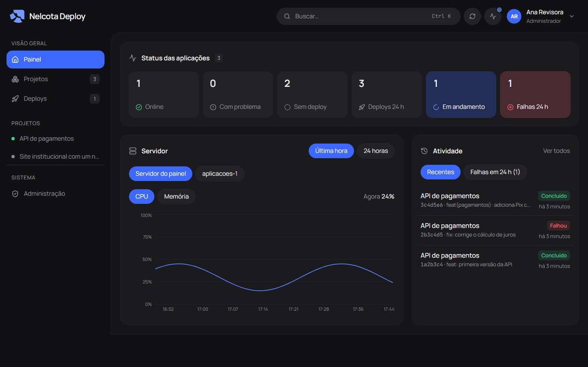
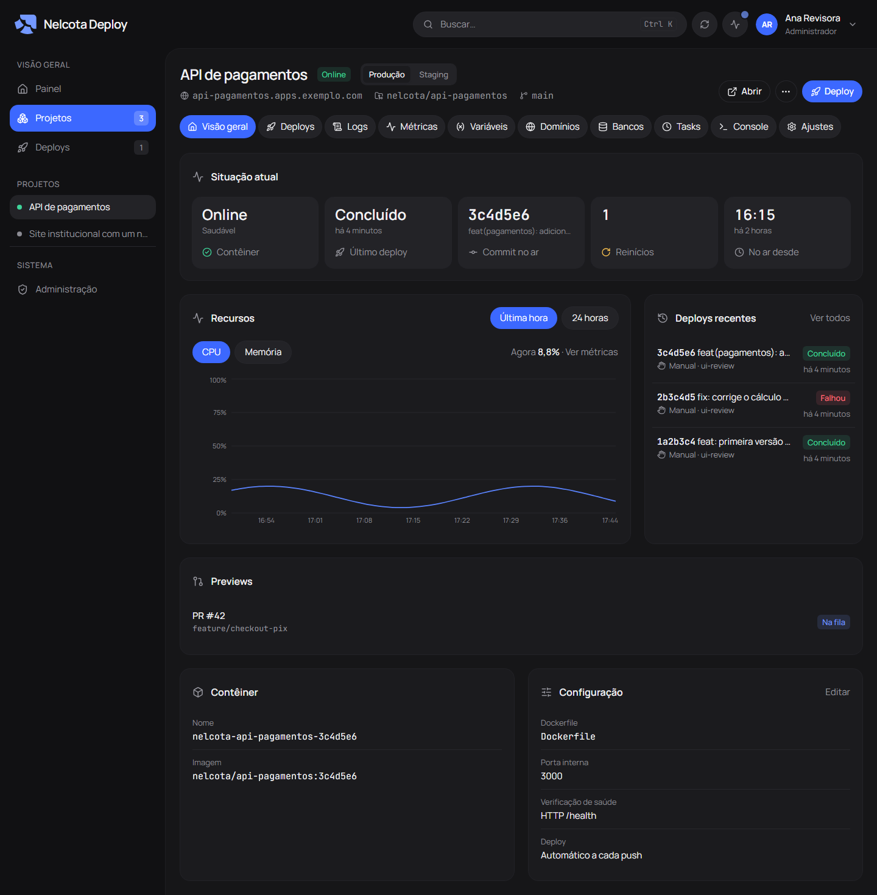
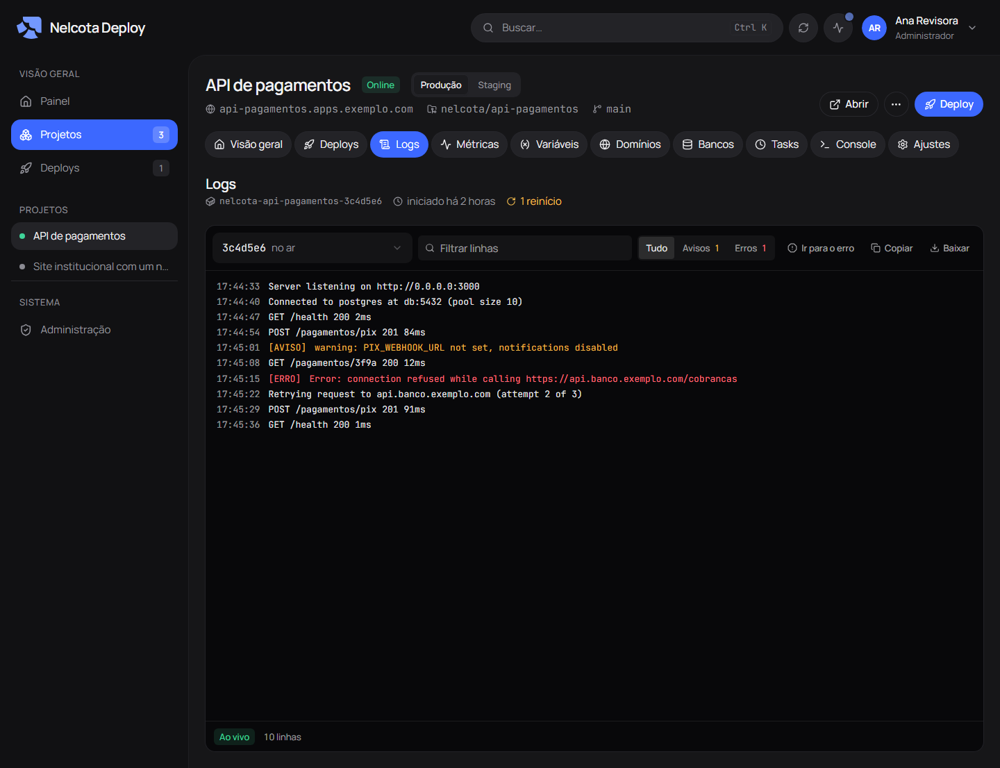
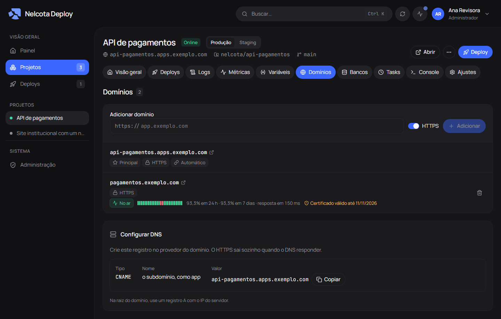
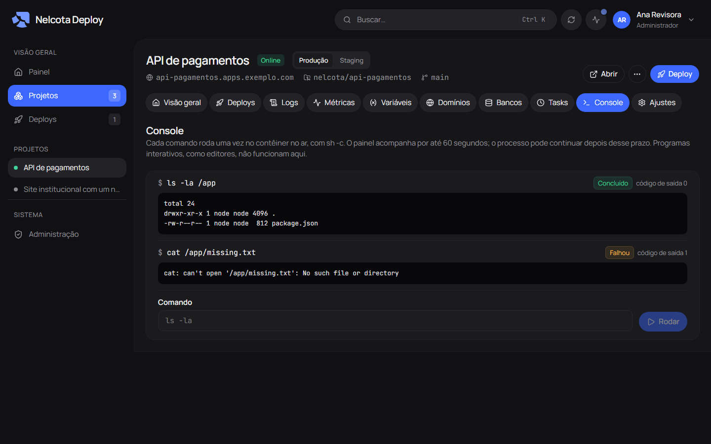

<div align="center">

<picture>
  <source media="(prefers-color-scheme: dark)" srcset="public/nelcota-logo-white.svg" />
  
</picture>

<h3>Nelcota Deploy</h3>

<p>Self-hosted deploy panel for Linux VPSs with Docker: one server or many over SSH.<br />
Push to GitHub, get a running container with logs, metrics, uptime checks and HTTPS.</p>

<p>
  <a href="https://github.com/Nelcota/NelcotaDeploy/actions/workflows/check.yml"></a>
  
  
  
</p>



</div>

## Why

Like Railway, Coolify and Dokploy, but smaller and built for a single organization. One Bun process serves the panel, another runs the builds; both share a SQLite
file. No Kubernetes, no external database, no agents to install.

## Features

| Area          | What it does                                                                                                                                                                                                                                                              |
| ------------- | ------------------------------------------------------------------------------------------------------------------------------------------------------------------------------------------------------------------------------------------------------------------------- |
| **Deploys**   | Build the exact commit from GitHub, on push or by hand, from a Dockerfile, with Railpack or from a Docker Compose file. Zero-downtime switch (Dockerfile and Railpack), rollback, retry and the deploy status on GitHub. New projects deploy once an admin approves them. |
| **Rollback**  | When a new version passes its health check but falls into a restart loop in the minutes after the switch, the panel goes back to the previous one by itself and sends an alert.                                                                                           |
| **Replicas**  | Up to 10 copies of an app behind Traefik's load balancer, all health checked before the switch.                                                                                                                                                                           |
| **Staging**   | A staging environment per project, with its own address and variables, and promotion of its live commit to production.                                                                                                                                                    |
| **Previews**  | Optional: up to 5 open pull requests to the project's branch each get a temporary address; forks never run.                                                                                                                                                               |
| **GitHub**    | Search repositories through the GitHub App or a saved read token; detect branches, Dockerfiles and directories from a selection or URL.                                                                                                                                   |
| **Logs**      | Live build and runtime logs with search, level filter, jump to the first error, copy and download. Start, stop and restart the app from the panel.                                                                                                                        |
| **Metrics**   | CPU and memory per container and for the host, with history.                                                                                                                                                                                                              |
| **Config**    | Discover and review .env imports, preserve existing values, and generate local signing secrets; changes restart or rebuild the app as needed.                                                                                                                             |
| **Volumes**   | Folders kept between deploys as Docker named volumes, which can be detached; their data is deleted only on request.                                                                                                                                                       |
| **Databases** | PostgreSQL, MySQL, MongoDB and Redis per project, with the URL in a secret variable, and daily encrypted backups with restore (all but Redis).                                                                                                                            |
| **Limits**    | Optional memory and CPU limits per application container.                                                                                                                                                                                                                 |
| **Domains**   | Automatic and custom domains, HTTPS by Let's Encrypt through Traefik, and a live check of each domain's DNS.                                                                                                                                                              |
| **Uptime**    | Every live domain is checked from the outside each minute, with availability and response time history, an alert when it goes down and a warning two weeks before its certificate expires.                                                                                |
| **Console**   | One-off commands in the live container from the browser, with the output as it runs. Available to anyone allowed to deploy the project, and each command goes to the audit log.                                                                                           |
| **Tasks**     | Discover package.json scripts, review commands and schedules, and keep queued runs bound to their original command and timeout.                                                                                                                                           |
| **Servers**   | Add a VPS with one pasted command; builds and apps run there over a persistent SSH connection, and moving a project to another server keeps its sites online. Build cache and dangling images are cleaned daily on each one.                                              |
| **Ops**       | Daily panel backups, encrypted off-site copies to any S3-compatible bucket (S3, R2, B2), and Discord or Slack alerts for failed deploys and backups, automatic rollbacks, apps, databases, domains or servers down and disks over 85% full.                               |
| **Team**      | Admin, developer and viewer roles; projects visible only to their members, each a manager, developer or viewer there; two-factor authentication, API tokens, an MCP server for AI clients and an audit log.                                                               |

<table>
  <tr>
    <td></td>
    <td></td>
  </tr>
  <tr>
    <td></td>
    <td></td>
  </tr>
</table>

## Quick start

Requires Linux with [Bun](https://bun.sh) 1.4+, git and Docker 23+ with the buildx and compose
plugins; Railpack builds also need [Railpack](https://railpack.com) installed.

Use a current browser with `Uint8Array.prototype.toBase64` support for avatar uploads and generated passwords.

Avatar uploads accept PNG, JPEG, and WebP up to 512 KiB and 1,048,576 total pixels. The server uses `Bun.Image` to decode every pixel with an explicit allocation limit, then stores a fresh encoding in the source format. The encoded output must also fit the 512 KiB limit.

Managed tasks and database commands require `sh` and Linux procfs inside the application
image. The supervisor uses them to stop commands and their descendants on timeout or cancellation;
command arguments are passed literally, without shell evaluation.

```bash
bun install
bun run setup    # writes .env with generated secrets
bun run dev      # panel on http://localhost:3000; the first visit creates the admin
bun run worker   # in another terminal: builds, tasks, metrics, uptime checks, backups
```

## Production

Point a DNS record such as `deploy.example.com` at a Linux VPS and allow inbound TCP ports 80 and 443. The installer supports `amd64` and `arm64`. It installs Docker Engine and Compose on Ubuntu
and Debian when Docker is absent. On other distributions, install Docker and Compose first.

From an empty directory on the VPS, download the installer and checksum from the latest release:

```bash
curl -fSLO --retry 3 https://github.com/Nelcota/NelcotaDeploy/releases/latest/download/nelcota-deploy.tar.gz &&
curl -fSLO --retry 3 https://github.com/Nelcota/NelcotaDeploy/releases/latest/download/nelcota-deploy.tar.gz.sha256 &&
sha256sum -c nelcota-deploy.tar.gz.sha256 &&
tar -xzf nelcota-deploy.tar.gz &&
sudo bash nelcota-deploy/install.sh
```

The installer asks for the panel domain and administrator email. Pass `--domain deploy.example.com`
and `--email admin@example.com` for unattended installation. It pulls the release image by digest,
creates the first administrator before starting Traefik, and checks `/api/health` over HTTPS.
The initial password is in `/opt/nelcota-deploy/initial-admin-password`, readable by root. Remove
that file after signing in. Back up `/opt/nelcota-deploy/.env` securely with the panel database.

If a step fails, fix the reported issue and run the installer again. It resumes using the same
configuration, image and Docker volumes. The same command also works from a complete source
checkout before a release is available (`sudo bash install.sh`). That path builds the image on
the VPS. Manage existing manual Compose installations from their original checkout.

Use `sudo docker compose --project-directory /opt/nelcota-deploy logs` for installer deployments.
Publishing a `vX.Y.Z` tag triggers the release workflow. For the first release, set the
`nelcotadeploy` GHCR package visibility to **Public** after the image has been pushed, then rerun
the publish job if it reported that the image was unavailable anonymously.

## Development

Each page has a single purpose. Application health, deployment activity, deployment statistics
and server metrics have separate destinations. Project status, previews, metrics, build logs,
runtime logs, DNS, variable imports, task history, database backups and restoration are also
separate pages with direct links. Opening a history or restoration page never starts a job.

Navigation groups global pages under **Geral**, **Deploys** and **Infraestrutura**. Project and
administration menus group destinations by subject; mobile menus expose the complete list.
Use **Ctrl+K** inside a project to find its pages, settings and current resource histories.
Search accepts words in any order and terms such as `Dockerfile`, `porta` and `backups`.
Menus, page headings and browser titles use descriptive names; former labels such as
`Build`, `Previews`, `Tasks` and `Volumes` remain available as search aliases.

For DNS automation, connect a Cloudflare API token in **Administração → Integrações → Conexão com a Cloudflare** with
zone read and DNS edit permissions for the relevant zones. The token is encrypted at rest.
The panel detects the server origin and previews exact record changes before confirmation;
mail and unrelated records are preserved. When the local panel uses a Cloudflare hostname,
the token also needs access to that hostname's zone to read its origin behind the proxy.
Existing environment variables are preserved when importing `.env.example`; external
credentials must be provided, while supported local signing secrets are generated automatically.

New projects also detect simple local HTTP GET health paths from the selected Dockerfile's
final stage. Existing settings and manual edits are preserved; unsupported probes stay manual.
Account creation and password resets start with a strong generated password. Pasting
`Name <email>` fills the explicit identity, and successful submissions show a one-time
credential receipt. Accounts, passwords and sessions change only after confirmation.

The individual variable editor accepts a pasted `NAME=value` assignment and detects secrets,
preview protection, application URLs and supported local signing secrets. Manual edits and
saved variables are preserved. Use **Variáveis → Importar .env** for local UTF-8 files or
**Variáveis → Importar do repositório** for `.env.example` discovery. Local file contents stay
in the browser until the reviewed import is confirmed.

Install Chromium once with `bunx playwright install chromium` before running browser checks.

```bash
bun run check         # format, lint, types, unused code, package size and tests
bun run test:browser  # keyboard, accessibility and browser encoding regressions
bun run ui:review     # screenshots of every screen plus an accessibility report
```

Built with Bun, TanStack Start, React, Tailwind, Drizzle, Better Auth and Traefik.

The full guide (architecture, GitHub App, MCP, backup, troubleshooting) is in
[docs/guia.md](docs/guia.md), in Portuguese.
