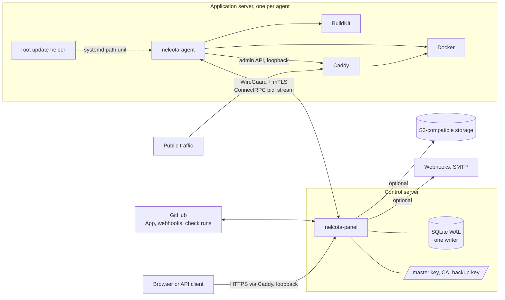
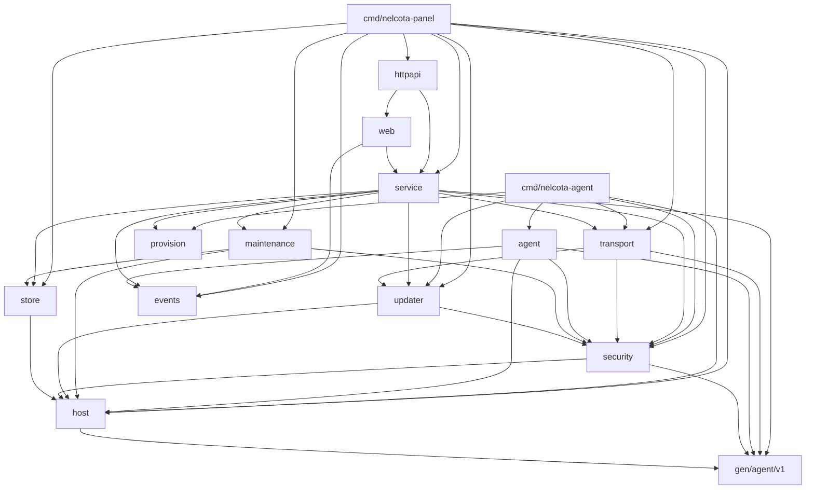
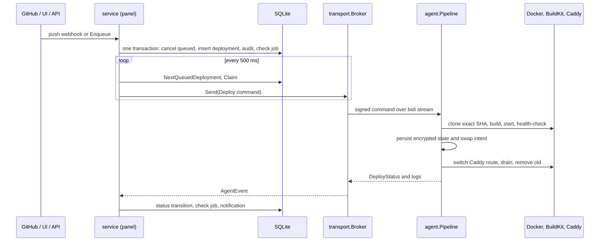

# Architecture overview

This page describes the system as it is built at commit `5636a52` (October 16, 2026). It is a map of the real code, not a target. The planned direction is in [target state](target-state.md); the problems that motivate it are in [current state](current-state.md).

## System context

NelcotaDeploy is two Go binaries and three third-party services.

- **Panel** (`cmd/nelcota-panel`): stores desired state, authenticates people and tokens, schedules deployments, serves the JSON API and the server-rendered interface, runs backups, updates, notifications, and GitHub check runs.
- **Agent** (`cmd/nelcota-agent`): dials the panel, verifies signed commands, builds images with BuildKit, runs hardened containers, health-checks them, switches Caddy routes, and reports heartbeats, logs, and metrics.
- **Trust boundaries:** the public API listens on loopback behind Caddy; the control RPC listens only on the WireGuard address and requires mTLS with pinned certificate fingerprints; every command is Ed25519-signed with a 30-second lifetime and replay protection.

## Packages and responsibilities

Sizes are non-test lines of hand-written Go and templ (generated code excluded).

| Package | LOC | Responsibility |
| --- | ---: | --- |
| `cmd/nelcota-panel` | 518 | Composition root, flags and environment, `serve`, `dev`, `dev-seed`, backup and restore commands |
| `cmd/nelcota-agent` | 216 | Composition root for the agent, `join` and `serve` |
| `internal/service` | 6,015 | Business rules and authorization for every panel feature; scheduler, agent events, check-run outbox, notifier, operations, enrollment, SSH provisioning, GitHub integration |
| `internal/store` | 110 + SQL | SQLite open (writer pool of one, read pool of four), goose migrations, sqlc queries |
| `internal/httpapi` | 821 | chi router, security headers, rate limits, sessions, CSRF, audit middleware, JSON handlers, `/api/events` SSE |
| `web`, `web/pages`, `web/ui`, `web/i18n`, `web/static` | 9,316 | Server-rendered interface (templ, Datastar SSE patches), components, English/Portuguese catalog, fingerprinted assets |
| `internal/transport` | 533 | ConnectRPC broker (panel) and client (agent), command signing on send, certificate renewal and update-preparation endpoints |
| `internal/security` | 471 | Vault (AES-GCM), hashing, Ed25519 command signing and verification, replay journal, CA and certificate rotation, log redaction |
| `internal/agent` | 1,560 | Deploy pipeline, reconcile loop, Docker/BuildKit/Caddy engine, base-image resolution, metrics |
| `internal/maintenance` | 1,070 | Encrypted backup archives, offline restore, weekly test restore, SigV4 S3 upload |
| `internal/updater` | 852 | Signed release verification (Minisign), root helper, health confirmation, rollback |
| `internal/host` | 362 | Private-file I/O, locks, HTTP server lifecycle, pprof and flight recorder, host metrics |
| `internal/events` | 227 | In-process pub/sub hub, bounded log rings, zstd log store |
| `internal/provision` | 20 | Join request and result DTOs shared by panel and agent |
| `internal/policy` | tests | English-only repository policy test |

## Package dependencies (observed)

Edges come from `go list` at `5636a52`; generated packages and the standard library are omitted.

There are no import cycles (the Go compiler forbids them). The direction is mostly sound: delivery packages (`httpapi`, `web`, `transport`) call `service`, and `service` calls `store`. The edges that work against that direction are listed in [current state](current-state.md#c-architectural-diagnosis): `service → transport`, `security → gen`, `host → gen`, and `transport → updater`.

## Main flows

### Deployment

### Request handling (panel)

`Recoverer → headers (CSP, HSTS, 1 MiB body cap) → per-IP rate limit → session (cookie or bearer token) → audit (non-GET) → CSRF (Origin and HMAC token)`, then either a JSON handler (`internal/httpapi`) or an interface handler (`web`). Both call the same `service` interfaces; the service re-checks authorization on every method.

### Background work (panel)

All long-running loops run in one `errgroup` in `cmd/nelcota-panel/main.go`: control listener, public listener, deploy scheduler, check-run outbox worker, notifier, operations runner (backups, updates, test restores), certificate rotation, session cleanup, disk relief, and peer sync.

## Data

- One SQLite file in WAL mode, `busy_timeout` 5 s, foreign keys on. Writes go through one connection (`internal/store/store.go:69`), so every `mutate` transaction is serialized in-process.
- 13 goose migrations with down sections. The audit log is append-only through triggers.
- Secrets (environment values, TOTP seeds, settings, pending certificates) are sealed with AES-256-GCM under `master.key`, with the record scope bound as associated data.
- Build and runtime logs are zstd files under the data directory, indexed by deployment.

## Quality gates in the repository

`make build test lint check-generated`, the race detector, integration tests with real Docker/BuildKit/Caddy, Playwright end-to-end, accessibility, and visual tests, asset budgets, benchmarks with benchstat, govulncheck, and the English-only policy test. CI pins every action by commit SHA. See [development](../development.md).
