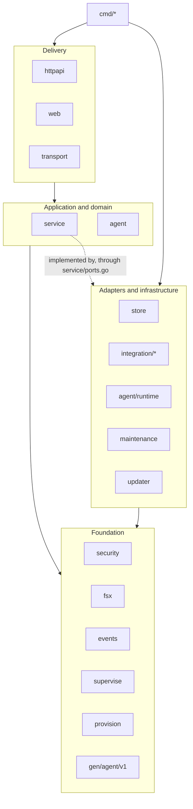

# Target state

Status: **proposed**, waiting for maintainer approval. This page chooses the architecture, the patterns, and the package layout that the [roadmap](../refactoring/roadmap.md) moves toward. Finding IDs (F-xx) refer to [current state](current-state.md).

## Constraints that drive the choice

- One maintainer team, two binaries, a single SQLite writer, and a deployment target of one control VPS plus a few application VPS instances.
- Strong existing guarantees that must not regress: authorization in `internal/service`, audit rows in the same transaction as the change, signed and replay-protected commands, hardened containers, reproducible generated code.
- The real defects are lifecycle coupling (F-01, F-02, F-06, F-07), consistency gaps (F-11, F-12), and infrastructure mixed into business code (F-17, F-19). None of them comes from a missing architectural style; all of them come from missing boundaries inside the current style.

## D. Architecture comparison

Scores are relative to this codebase (5 = best fit). "Incremental" means it can be adopted package by package without a rewrite.

| Option | Fit | Cost | Testability | Incremental | Verdict |
| --- | :-: | :-: | :-: | :-: | --- |
| **Modular monolith** (two binaries) | 5 | already in place | 4 | 5 | **Keep as the primary structure.** The binaries already split along the trust boundary (control vs. host authority). |
| Layered architecture | 4 | low | 3 | 5 | **Keep** the existing delivery → service → store direction and make it enforceable. |
| Hexagonal (ports and adapters), applied everywhere | 3 | high | 5 | 3 | **Apply only at external boundaries** (agent dispatch, GitHub, mail and webhooks, SSH, WireGuard, object storage, container runtime). Wrapping sqlc behind repositories would add a second data layer with no gain: sqlc already generates a typed query layer and `mutate` already is the unit of work. |
| Clean / Onion architecture | 2 | high | 4 | 2 | **Reject.** Entity/use-case/interface-adapter rings mean mapping types at every layer; Go idiom and the project size favor fewer packages with consumer-defined interfaces. |
| Vertical slice / feature-based | 4 | medium | 4 | 4 | **Use inside packages, not as package splits yet.** `internal/service` is already organized by feature files; splitting it into sub-packages now would fight the shared transaction helper and the shared `Core`. Revisit after stage S6 if a feature has no shared state ([ADR-0002](decisions/0002-modular-monolith-with-boundary-ports.md)). |
| Domain-driven design | 3 | medium | 4 | 4 | **Tactical subset only:** an explicit deployment state machine and typed status values (F-34, F-11), and value validation at the service boundary. No aggregates or bounded-context machinery: the domain is one context. |
| Event-driven architecture | 3 | medium | 3 | 4 | **Narrow use:** keep the in-process hub for live views, which are allowed to drop events. Move side effects that must not be lost (notifications) to a durable outbox, the pattern already used for check runs ([ADR-0005](decisions/0005-durable-notification-outbox.md)). |
| CQRS | 1 | high | 3 | 3 | **Reject.** Separate read and write pools already exist; there is no read-model scaling problem. Batched read queries solve F-23. |
| Microservices | 1 | very high | 2 | 1 | **Reject.** A single SQLite writer, a small team, and a self-hosted target make network splits pure cost. |

### Selected architecture

**A modular monolith in two binaries, with an enforced layered dependency direction and ports and adapters at external boundaries only**, plus three targeted techniques:

1. **Lifecycle separation** on the agent: jobs belong to the process, not to the control session ([ADR-0003](decisions/0003-agent-jobs-outlive-control-sessions.md)).
2. **Supervised background loops** on the panel: a loop failure is logged and retried, and only startup failures stop the process ([ADR-0004](decisions/0004-supervised-background-loops.md)).
3. **Durable outbox** for side effects that must survive restarts and bursts ([ADR-0005](decisions/0005-durable-notification-outbox.md)).

This combination fixes every critical and high finding without moving more than a handful of files at a time, keeps the existing test suites valid, and matches Go conventions (small consumer-side interfaces, packages named for what they provide, no `utils`).

## E. Design patterns

Only patterns that solve a finding are listed. Patterns considered and rejected are at the end.

### E1. Worker queue with a session-independent event sink (agent)

- **Problem:** F-01, F-02, F-03.
- **Where:** `internal/agent/pipeline.go`, `internal/transport/connect.go`, `cmd/nelcota-agent/main.go`.
- **Why it fits:** the receive loop must stay responsive; jobs must outlive sessions; results must be reported, not thrown.
- **Shape:**

```go
// The receive loop only verifies and enqueues.
type Inbox interface{ Submit(*agentv1.Command) error } // returns ErrBusy instead of blocking

// The sink outlives sessions; events are buffered while disconnected.
type Sink interface{ Emit(*agentv1.Event) } // never returns a session error

func (p *Pipeline) Run(ctx context.Context) error // owns job contexts and the reconcile goroutine
```

  `Handle` errors become `OperationResult` or `DeployStatus` events with an error code; only verification failures (signature, replay, expiry) end a session, and those are logged.
- **Benefit:** reconnects no longer fail deployments; slow reconcile no longer expires commands.
- **Added complexity:** one buffered queue and one bounded event buffer with a drop policy for logs (status events are never dropped; they are coalesced per deployment).
- **Simpler alternative considered:** only changing `jobCtx` to derive from `Run`'s context. It fixes cancellation but not the dead `emit` or command expiry, so it is step 1 of this pattern, not a replacement.
- **Done when:** a test reconnects the transport during a fake-engine deploy and the deploy completes and reports; a test with a 90 s reconcile shows no command expiry; session end reasons appear in logs.

### E2. Supervisor for long-running loops (panel and agent)

- **Problem:** F-06, F-13.
- **Where:** `cmd/nelcota-panel/main.go`, `internal/service/checks.go`, `deploys.go`, `internal/security/certificates.go`.
- **Shape:**

```go
// supervise runs loop until ctx ends; errors are logged and retried with capped backoff.
func Supervise(ctx context.Context, name string, loop func(context.Context) error)
```

- **Benefit:** transient failures stop restarting the panel; each loop has a name in logs.
- **Alternative:** fix each loop to never return errors. That spreads the same retry logic five times.
- **Done when:** injecting a database error into `RunChecks` keeps the panel serving and logs one error per backoff step.

### E3. Transactional outbox for notifications

- **Problem:** F-07; notification bursts and restarts lose alerts.
- **Where:** `internal/service/notifier.go`, `notify_delivery.go`, a new migration.
- **Why it fits:** the project already runs an outbox with retry for check runs (`internal/service/checks.go`), so the pattern and its tests exist.
- **Shape:** the transaction that changes a deployment or server status also inserts a `notification_jobs` row; a worker delivers with backoff and marks rows done; the hub subscription is removed from the notifier.
- **Complexity:** one table, one worker, one retention rule.
- **Simpler alternative:** resubscribe when the hub closes the channel. It fixes permanent silence but still drops events during bursts and restarts. Acceptable as an interim fix in stage S2.
- **Done when:** a test publishes 1,000 events while the delivery endpoint is down, restarts the service, and every eligible notification is delivered once.

### E4. Optimistic concurrency with the existing revision column

- **Problem:** F-12, F-11.
- **Where:** `internal/service/core.go` (`save`, `Action`), `github.go` (installation update), `deploys.go` (`Cancel`, status transitions), `web/appsettings.go` (send the revision).
- **Shape:** `UPDATE ... WHERE id=? AND revision=?` and `UPDATE deployments SET status=? WHERE id=? AND status=?`; a zero-row result maps to a `Conflict` error with a clear message.
- **Done when:** tests run two concurrent saves and a cancel racing a claim; exactly one save wins and the cancel either prevents dispatch or sends a cancel command.

### E5. Ports at external boundaries, constructor injection

- **Problem:** F-16, F-17.
- **Where:** `internal/service/core.go`, `notify_delivery.go`, `provision.go`, `enrollment.go`, `github.go`; new adapter packages (section F).
- **Shape:** interfaces declared in `internal/service/ports.go` by the consumer, implemented in adapter packages; `service.New(Deps)` validates required dependencies and returns a ready `Core`; optional features use explicit flags (`Deps.CheckRuns bool`) or a no-op adapter, not nil checks.

```go
type Mailer interface{ Send(ctx context.Context, m Mail) error }
type WebhookPoster interface{ Post(ctx context.Context, target string, body []byte, signed bool) error }
type PeerConfigurer interface{ AddPeer(ctx context.Context, p Peer) error; RemovePeer(ctx context.Context, key string) error }
```

- **Benefit:** faster, narrower service tests; adapters tested on their own with fakes or local servers (as today).
- **Rejected variant:** a dependency-injection framework. Plain constructors are enough for two binaries.
- **Done when:** `internal/service` no longer imports `net/smtp`, `x/crypto/ssh`, `wgctrl`, `go-github`, or `internal/transport`, enforced by the dependency test (E7).

### E6. Explicit deployment state machine

- **Problem:** F-34, F-11, and the size of `AgentEvent` (F-28 safety net first).
- **Where:** a new `internal/service/deployment_state.go`; used by `deploys.go`, `web/pages/explain.go`, `web/ui/format.go`.
- **Shape:** a `DeploymentStatus` string type with constants and `func (s DeploymentStatus) CanMoveTo(next DeploymentStatus) bool`; the transition table is the single source for service checks and SQL guards.
- **Done when:** no status literal remains outside the state file (checked with `grep` in CI or a test), and `AgentEvent` is split into one handler per event kind with cognitive complexity under 30 each.

### E7. Architecture fitness test

- **Problem:** boundaries erode silently (F-17, F-19).
- **Where:** `internal/policy/imports_test.go`, next to the English policy test.
- **Shape:** a table of allowed import edges checked with `go list -deps -json`; a violation names the edge and the rule.
- **Done when:** the test fails on a deliberately added forbidden import and passes on the current tree after each stage's moves.

### Considered and not recommended

| Pattern | Reason |
| --- | --- |
| Repository over sqlc | sqlc already is a typed repository; a second layer would only map types |
| Unit of Work object | `Core.mutate` already gives one transaction per use case |
| Specification | Queries are fixed and few; SQL is clearer |
| Saga | No distributed transaction; the agent swap intent and heartbeat repair already cover cross-process recovery |
| Circuit breaker | Each external call is single-target and low volume; timeouts and backoff (E2, checks outbox) are enough |
| Mediator, Observer frameworks | The in-process hub already is the observer; adding a mediator would hide call paths |
| Result type | Go's `(value, error)` with the typed `*service.Error` is the idiomatic result |

## F. Proposed organization

The tree shows the end state; paths marked *new* or *moved* change, everything else stays. Moves happen one package per change (roadmap stage S6).

```text
cmd/
  nelcota-panel/          composition root: config loading, wiring, supervised loops
    config.go             new: one Config struct from flags and environment, validated once
  nelcota-agent/          composition root for the agent
internal/
  service/                business rules and authorization (unchanged role and import path)
    ports.go              new: Dispatcher, GitHubAPI, Mailer, WebhookPoster, PeerConfigurer, HostKeyScanner, ObjectStore
    deployment_state.go   new: statuses and transitions
    apps.go deploys.go scheduler.go agentevents.go ...   feature files (split from core.go and deploys.go)
  store/                  SQLite open, migrations, sqlc queries; all SQL lives here
  integration/            new: adapters to third-party systems, one package each
    github/               moved from service/github.go client code (go-github, ghinstallation)
    mail/                 moved from service/notify_delivery.go (SMTP)
    webhook/              moved from service/notify_delivery.go (SSRF-safe HTTP poster)
    sshinstall/           moved from service/provision.go (x/crypto/ssh)
    wireguard/            moved from service/enrollment.go (wgctrl)
  transport/              ConnectRPC broker and client, session supervision
    command.go            moved from security: Sign and Verifier for agentv1.Command
  agent/                  pipeline, job queue, reconcile, Engine interface
    runtime/              moved: DockerEngine, BuildKit, Caddy adapters (docker.go, bases.go, metrics.go)
  security/               primitives only: vault, hashing, CA and certificates, redaction; no proto imports
  fsx/                    moved from host: private files, locks, atomic writes (name chosen to avoid os/fs clashes)
  diag/                   moved from host: pprof and flight recorder, loopback-only by default
  hostmetrics/            moved from host: gopsutil host metrics returning plain structs
  serve/                  moved from host: HTTP server lifecycle shared by both binaries
  supervise/              new: Supervise loop helper (E2)
  maintenance/            backups, restore, S3 (ObjectStore adapter)
  updater/                signed updates and root helper
  events/                 in-process hub, log rings, log store
  provision/              join DTOs shared by panel and agent
  policy/                 English policy test and import rules (E7)
  httpapi/                JSON API, sessions, CSRF, rate limits, error mapping (single source)
web/                      interface handlers, pages, ui, i18n, static (unchanged layout)
```

### Dependency rules (enforced by E7)



| Rule | Reason |
| --- | --- |
| `service` may import `store`, `events`, `security`, `provision`, `gen`, `maintenance` (backup creation), and its own ports; never `transport`, `integration/*`, `httpapi`, `web`, or network client libraries | Business rules stay testable without infrastructure |
| `agent` may import `gen`, `security`, `fsx`, `events`; `agent/runtime` is the only package importing Moby, BuildKit, or Caddy clients | The pipeline stays testable with fakes |
| `security`, `fsx`, `events`, `supervise` import no project package except each other and the standard library | Foundations stay leaf packages |
| `web` imports `service`, `events`, `web/*`; it may use `httpapi` only for the shared error mapping, or that mapping moves to `service` | One error-to-status mapping (F-33) |
| Only `cmd/*` wires adapters to ports | Composition happens in one place |

### Cross-cutting conventions

Error handling, validation, logging, configuration, testing, and naming rules are in [engineering conventions](../engineering/conventions.md).
