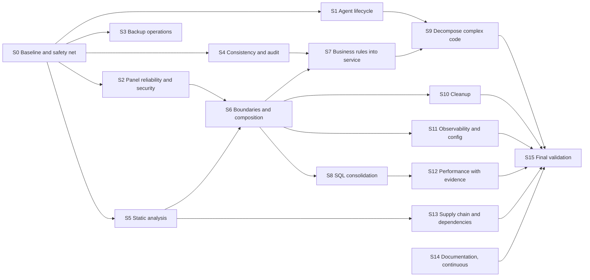

# Refactoring roadmap

Status: **proposed, not started.** No stage begins before maintainer approval. Findings (F-xx) are in [current state](../architecture/current-state.md), the destination in [target state](../architecture/target-state.md), tasks in the [backlog](backlog.md), risks in the [risk matrix](risks.md).

## Principles

- Each change is small, keeps public behavior unless an ADR approves a change, and passes `make build test lint check-generated` plus the race detector before merge. Changes touching the agent, Docker, BuildKit, or Caddy also pass `make test-integration` on real infrastructure; missing infrastructure is not a pass.
- No rewrite. Packages move one at a time; each move is a separate commit that only moves code, followed by a commit that changes it.
- Behavior changes ship behind tests written first (characterization or failing reproduction).
- Local verification is not VPS acceptance. Stages S1 and S3 additionally need the matching [VPS acceptance](../vps-testing.md) steps before a release claims them.

## Sequence

Total estimate: **47–82 engineer-days**. The spread comes mainly from unknown linter findings (S5), raw-SQL volume (S8), and whether S1 exposes more agent defects under fault injection.

## Stages

### S0. Baseline and safety net

- **Priority:** P0. **Effort:** 4–6 d. **Depends on:** nothing.
- **Objective:** freeze the current behavior in tests before changing it.
- **Resolves:** F-28; prerequisite for every other stage.
- **Affected:** `internal/store` (new tests), `internal/service/*_test.go`, `internal/agent/pipeline_test.go`, `internal/transport/connect_test.go`, `internal/httpapi/router_test.go`.
- **Changes:**
  - Migration test: every migration up, then down to zero, then up again on an empty database; schema fingerprint compared to a golden file.
  - Characterization tests for `AgentEvent` (each event kind, ownership rejection, `observedState` repair), `Cancel` against a concurrent claim (documents F-11 as a failing test marked with `t.Skip` and the finding ID until S4), and `appsService.Action`/`Delete`.
  - Agent: fake-engine deploy across a transport reconnect (documents F-01 as skipped until S1); reconcile with a slow engine and queued commands (F-02).
  - JSON API smoke tests for apps, users, tokens, operations, settings through `httpapi.New` with the existing harness.
  - Record the baseline from [current state](../architecture/current-state.md#baseline-clean-worktree-at-5636a52-go-1269-cgo-disabled-unless-noted) in CI artifacts (coverage profile, gocognit top 25, benchmark results).
- **Risks:** characterization tests that encode a bug as expected behavior. Mitigation: each known defect is a skipped test that names its finding, never an asserted wrong value.
- **Rollback:** tests only; revert the commit.
- **Required tests:** the new tests themselves, race detector.
- **Done when:** all new tests pass or are skipped with a finding ID; `internal/store` coverage above 0; JSON handlers for the five areas each have at least one success and one authorization-failure test.

### S1. Agent session and job lifecycle

- **Priority:** P0. **Effort:** 4–7 d. **Depends on:** S0.
- **Objective:** a reconnect or a slow command never fails deployments ([ADR-0003](../architecture/decisions/0003-agent-jobs-outlive-control-sessions.md)).
- **Resolves:** F-01, F-02, F-03, F-04, F-45.
- **Affected:** `internal/agent/pipeline.go`, `internal/transport/connect.go`, `cmd/nelcota-agent/main.go`, tests.
- **Changes:**
  1. Log every session end with its reason (F-04). Ship alone first; it helps diagnose the rest.
  2. Derive job contexts from `Pipeline.Run`; introduce a session-independent event sink with a bounded buffer; status events coalesced, never dropped.
  3. Move reconcile to its own goroutine; the receive loop only verifies and enqueues.
  4. Report handler failures as events instead of returning errors; keep verification failures as session errors.
  5. Configure HTTP/2 read-idle ping on the agent transport.
- **Risks:** R-01 (event ordering changes confuse the panel's transition checks), R-02 (buffer growth while disconnected).
- **Rollback:** each numbered change is its own commit; reverting step 2–4 restores the previous lifecycle without protocol changes (the protocol does not change in this stage).
- **Required tests:** S0 reconnect and slow-reconcile tests un-skipped and passing; goleak; race; `make test-integration` (route swap under traffic still loss-free); VPS acceptance stage for deploy during a panel restart before any release claims it.
- **Done when:** a deploy survives a forced reconnect in tests and in integration; no command expires during a 90-second reconcile; capacity rejection produces a failed `DeployStatus` and the session stays up.

### S2. Panel reliability and security fixes

- **Priority:** P0. **Effort:** 3–5 d. **Depends on:** S0; F-05 needs the [ADR-0006](../architecture/decisions/0006-fresh-authentication-for-sensitive-writes.md) choice.
- **Objective:** close the high security finding and stop transient failures from killing or silencing the panel.
- **Resolves:** F-05, F-06, F-07 (interim), F-13, F-24, F-31, F-32.
- **Changes:**
  - Apply the ADR-0006 decision to `settings.Set`, user creation, and `SetRole`.
  - Add `internal/supervise` and run every work loop under it ([ADR-0004](../architecture/decisions/0004-supervised-background-loops.md)); add deadlines to scheduler calls (`GitHub.Token`, `Control.Send`); log scheduler errors.
  - Notifier resubscribes when the hub closes its channel, and logs the drop (interim for ADR-0005).
  - `web.Register` denies when `Authorized` is nil; `provisionStream` re-checks credentials on its keepalive.
  - Bind pprof and the flight recorder to loopback by default, with an explicit flag for the WireGuard address.
  - Log untyped errors in web `act` and `failPage`; stop logging `context.Canceled` as failure.
- **Risks:** R-03 (API clients relying on token access to sensitive writes).
- **Rollback:** per-item commits; the authorization change is one commit that can be reverted independently.
- **Required tests:** token refused on each sensitive path; error and panic injection into `RunChecks` with the panel still serving; notifier receives events after a forced hub drop; nil-callback denial.
- **Done when:** all tests above pass; release notes draft lists the authorization change.

### S3. Backup operations

- **Priority:** P1. **Effort:** 2–4 d. **Depends on:** S0.
- **Objective:** backups never fill the disk and verification proves what operators rely on.
- **Resolves:** F-08, F-09, F-10.
- **Changes:**
  - Record local creation and remote upload separately; prune and verify local archives regardless of upload; surface upload failures as an operation status and notification.
  - Prune manual snapshots by age or count (decision in the change, documented in [operations](../operations.md)), or add the documented removal action.
  - Separate timeouts for creation and upload; size-aware upload timeout; evaluate multipart upload for archives over a threshold.
  - Show a backup key fingerprint in System settings and warn when `NELCOTA_BACKUP_KEY_FILE` points inside the panel's configuration directory.
- **Risks:** R-04 (pruning deletes the only good copy). Mitigation: never prune the newest verified archive.
- **Rollback:** revert; archive format unchanged.
- **Required tests:** retention with upload failing for 10 simulated days; manual snapshot pruning; upload timeout path with a slow local TLS server.
- **Done when:** tests pass and [operations](../operations.md) matches the behavior.

### S4. Data consistency and audit

- **Priority:** P1. **Effort:** 3–6 d. **Depends on:** S0; audit retention needs a short ADR.
- **Objective:** no silent lost updates; audit records match outcomes.
- **Resolves:** F-11, F-12, F-14, F-39.
- **Changes:**
  - `Cancel` reads and branches inside the write transaction; scheduler skips `cancel_requested`; status updates guarded by the expected current status.
  - `save` and `Action` use the `revision` check; the installation update increments the revision; web forms send the revision and show a conflict message.
  - `/ui` actions record the action's real outcome in the audit row; anonymous requests rejected before authentication are not audited (decision in a new ADR, which also defines audit retention or explicitly keeps it unbounded).
  - Move WireGuard peer changes and key generation out of the writer transaction in `Join`, with compensation on failure.
- **Risks:** R-05 (new conflict errors surface in the interface), R-06 (audit change conflicts with the append-only trigger).
- **Rollback:** each item revertible; no schema change except a possible audit-retention migration with a down section.
- **Required tests:** S0 Cancel test un-skipped; concurrent save test; audit outcome test for a failing `/ui` action.
- **Done when:** tests pass; no `UPDATE deployments SET status` without a status guard (checked by `grep` in review).

### S5. Static analysis

- **Priority:** P1. **Effort:** 3–5 d (high uncertainty). **Depends on:** S0.
- **Objective:** catch the bug classes the current linter set cannot see, before large refactors.
- **Resolves:** F-25, F-38.
- **Changes:** enable `errcheck` (with an explicit exclude list for intentional discards), `staticcheck`, `errorlint`, `bodyclose`, `contextcheck`, `gosec` (reviewed rules only), `gocognit` with a threshold of 30 for new or changed functions (existing ones listed as exclusions until S9). Replace the deprecated Moby constructor.
- **Risks:** R-07 (large mechanical diff hides behavior changes). Mitigation: one linter per commit; fixes reviewed separately from enabling.
- **Rollback:** disable a linter in `.golangci.yml`.
- **Done when:** `golangci-lint run` passes with the new set in CI; the exclusion list is documented with reasons.

### S6. Boundaries and composition

- **Priority:** P2. **Effort:** 6–10 d. **Depends on:** S2, S5.
- **Objective:** make the dependency direction real and enforced ([ADR-0002](../architecture/decisions/0002-modular-monolith-with-boundary-ports.md), [ADR-0007](../architecture/decisions/0007-enforce-package-dependency-rules.md)).
- **Resolves:** F-16, F-17, F-19, F-44.
- **Changes (one per commit, in this order):**
  1. Add the dependency test with today's violations in its allowlist.
  2. `cmd/nelcota-panel/config.go`: one validated `Config` from flags and environment; bound `BuildLimit` in the agent.
  3. `service.New(Deps)` and `service/ports.go`; remove post-construction assignment and nil-as-flag checks.
  4. Move adapters: `integration/webhook`, `integration/mail`, `integration/sshinstall`, `integration/wireguard`, `integration/github`; replace `transport.Peer` in service signatures with a service-owned type.
  5. Move command signing to `transport/command.go`; `security` stops importing `gen`.
  6. Split `host` into `fsx`, `serve`, `diag`, `hostmetrics`; move the update-preparation endpoint types out of `transport → updater` coupling.
  7. Move `DockerEngine`, BuildKit, and Caddy code to `internal/agent/runtime`.
- **Risks:** R-08 (wide moves conflict with parallel feature work). Mitigation: move commits contain no logic changes and land quickly.
- **Rollback:** each move commit reverts cleanly; the allowlist entry comes back with it.
- **Required tests:** full suite plus integration after steps 4, 6, 7.
- **Done when:** the dependency test allowlist is empty; `internal/service` imports none of `net/smtp`, `x/crypto/ssh`, `wgctrl`, `go-github`, `internal/transport`.

### S7. Business rules into the service

- **Priority:** P2. **Effort:** 4–6 d. **Depends on:** S4, S6.
- **Objective:** one place for deployment policy, status rules, and error mapping.
- **Resolves:** F-15, F-33, F-34, F-07 (final, [ADR-0005](../architecture/decisions/0005-durable-notification-outbox.md)).
- **Changes:**
  - `Deploys.EnqueueRef(ctx, app, ref)` (latest, short or full SHA, redeploy) used by web and exposed by the JSON API; `Apps.CreateAndPublish` in one transaction plus enqueue.
  - `deployment_state.go` with typed statuses and transitions; web and SQL guards use it.
  - A `Reauthentication` error kind instead of message matching; one status mapping function used by both `httpapi` and `web`.
  - Notification outbox table and worker; notifier no longer subscribes to the hub.
- **Risks:** R-09 (API surface change), R-10 (outbox duplicates).
- **Rollback:** the old web code path stays until the new service method is proven, then is removed in a separate commit.
- **Required tests:** the existing web deploy tests unchanged and passing; new service tests for each ref form; outbox restart test.
- **Done when:** `web/dashboard.go` no longer resolves SHAs; no status string literals outside `deployment_state.go` and SQL; notification outbox test passes.

### S8. SQL consolidation

- **Priority:** P2. **Effort:** 4–8 d. **Depends on:** S6.
- **Objective:** every query is checked against the schema at generate time.
- **Resolves:** F-18.
- **Changes:** move raw `Exec/Query*Context` calls into `internal/store/queries/*.sql`, one feature file per commit; keep `json_set`/`json_extract` where needed through sqlc's SQLite support; add a test that fails when `internal/service` calls `database/sql` query methods directly (outside the transaction helper).
- **Risks:** R-11 (subtle type changes, for example `NULL` handling, in generated code).
- **Rollback:** per-feature commits.
- **Done when:** raw query count in `internal/service` is zero or each remaining call has a documented reason; `make check-generated` clean.

### S9. Decompose complex code and close crash windows

- **Priority:** P2. **Effort:** 4–7 d. **Depends on:** S1, S7.
- **Objective:** no function above cognitive complexity 30 in the critical paths; agent crash recovery is complete.
- **Resolves:** F-21, F-22, the complexity table in current state.
- **Changes:** split `AgentEvent` into one handler per event kind; `OperationsService.step` into per-phase functions; `runOnce` into session setup, send loop, and receive loop; `Pipeline.reconcile` and `deploy`; `Trust.Apply`; `main.serve` (already reduced by S6). Agent startup sweeps containers and build directories by label that are not in persisted state; save state before routing in the reconcile replacement path. Updater re-run detects "new binary installed but unconfirmed" and completes or rolls back.
- **Risks:** R-12 (refactor changes behavior of the update helper, which runs as root).
- **Rollback:** per-function commits.
- **Required tests:** S0 characterization tests unchanged; new crash-window tests with the fake engine; updater re-run test.
- **Done when:** gocognit exclusions from S5 are removed for these functions; the crash-window tests pass.

### S10. Cleanup and duplication

- **Priority:** P3. **Effort:** 1–2 d. **Depends on:** S6.
- **Resolves:** F-35, F-36, F-37, F-43, F-46.
- **Changes:** remove `.goreleaser.yaml` (confirm no external use first), the agent `rings` map, unused SSE modes, and redirect stubs (keep the redirects if bookmarks matter; decide in the change); add `*.test` to `.gitignore`; sanitize `TestS3` errors; raise the body limit only for the webhook route (GitHub's documented cap is 25 MB); extract the duplicated helpers listed in F-46.
- **Done when:** `staticcheck` reports no unused code; the webhook size test passes.

### S11. Observability and configuration

- **Priority:** P2. **Effort:** 2–3 d. **Depends on:** S6.
- **Objective:** structured, consistent logs that answer "what failed and where".
- **Changes:** configure one `slog` handler per binary (JSON in production, text in dev) with level from configuration; standard attributes (`loop`, `server`, `app`, `deployment`, `request_id`); request ID middleware; agent logs deploy failures locally; document metrics already exposed.
- **Done when:** a failed deploy and a failed loop can each be traced from one log query; conventions updated.

### S12. Performance with evidence

- **Priority:** P3. **Effort:** 2–4 d. **Depends on:** S8.
- **Objective:** fix only what measurements confirm.
- **Resolves (if confirmed):** F-23, F-40, F-41.
- **Changes:** add benchmarks for `shell()`/dashboard render with 50 apps × 100 deployments and for snapshot construction; run `EXPLAIN QUERY PLAN` on the queue query with 100,000 deployments; then batch "latest deployment per app", compute alerts lazily, add indexes, cache redactors per app revision, as the numbers justify.
- **Done when:** each change has a before/after benchstat result in its commit message; regressions above 20% fail CI as today.

### S13. Supply chain, CI, and dependencies

- **Priority:** P2. **Effort:** 3–5 d. **Depends on:** S5.
- **Resolves:** F-20, F-26, F-27, F-42.
- **Changes:**
  - Pin Caddy in CI by version and checksum; add `-tags=integration` to the race job where infrastructure exists; pin test images by digest; add the Docker ecosystem to Dependabot.
  - Generate an SBOM and a build-provenance attestation in `release.yml`; document the required reviewers on the `release` environment and check them in the release checklist.
  - Add a cross-version signing test (golden signed commands verified by the current code) before any protobuf library bump; decide on signing raw payload bytes in a protocol ADR.
  - Upgrade direct dependencies one per change, reading each changelog: go-webauthn 0.14 → 0.18 (API changes expected), go-sqlite3 0.30 → 0.35 (driver and WASM changes), connect 1.21, goose 3.29, templ (re-check `templ fmt`). Evaluate Go 1.27 after its first two point releases are available in CI images; 1.26 remains supported until Go 1.28 is released.
- **Done when:** release dry run produces SBOM and attestation; every upgrade passes the full suite including integration and Playwright.

### S14. Documentation (continuous)

- **Priority:** P2. **Effort:** 1–2 d plus updates in each stage.
- **Resolves:** F-29.
- **Changes:** fix the stale statements listed in F-29; add pointers from `decisions.md` to superseding ADRs; keep [overview](../architecture/overview.md) and [current state](../architecture/current-state.md) updated at the end of each stage; add a threat model page and a host-loss recovery runbook (backup key plus S3 only).
- **Done when:** every stage's completion commit updates the documents it affects.

### S15. Final validation and audit

- **Priority:** P3. **Effort:** 1–2 d locally, plus VPS acceptance (not estimated here).
- **Changes:** rerun the full baseline, compare coverage, complexity, benchmarks, and dependency findings to S0; re-audit the findings list and mark each one fixed, accepted, or deferred with a reason; run the [VPS acceptance guide](../vps-testing.md) stages affected by S1, S3, and S13.
- **Done when:** the [Definition of Done](#definition-of-done) holds and the results are recorded in [status](../status.md).

## Test strategy

| Layer | What it protects | Tools and rules |
| --- | --- | --- |
| Characterization | Current behavior of code about to change | Written in S0 and before any refactor of an untested function; known defects are skipped tests naming the finding |
| Unit (service) | Authorization, transitions, validation, transactions | Real SQLite in a temp directory (as today); fakes for every port after S6 |
| Unit (agent) | Pipeline, reconcile, lifecycle | Fake `Engine` and fake transport; goleak in every package that starts goroutines |
| Fault injection | Reconnects, slow handlers, loop errors, panics, crashes between steps | Deterministic fakes with controllable delays and failure points; no sleeps longer than test timeouts |
| Contract | Panel and agent compatibility, JSON API | Golden signed commands (S13); proto field numbers never reused; JSON API tests through `httpapi.New` |
| Migration | Schema evolution | Up, down, up on an empty database; golden schema; restore of a backup made by the previous release |
| Integration | Docker, BuildKit, Caddy, installers | `make test-integration` on real infrastructure; missing infrastructure fails |
| End to end | Interface flows, accessibility, budgets | Playwright against `nelcota-panel dev`, axe, asset and page budgets, visual gallery |
| Performance | Regressions in hot paths | Benchmarks with `b.Loop()`, benchstat in CI, 20% regression gate |
| Race and leaks | Concurrency | `-race` in CI, goleak |
| VPS acceptance | Real systemd, firewall, WireGuard, reboot, passkeys | [VPS guide](../vps-testing.md); results recorded, never inferred from local runs |

Coverage is reported per package but is not a goal by itself; a stage is judged by the specific tests in its "Done when".

## Definition of Done

The modernization is complete when all of the following are verified and recorded:

1. Every critical and high finding (F-01 to F-05) is fixed with a test that failed before the fix, or accepted in an ADR.
2. Every medium finding is fixed, accepted in an ADR, or moved to a dated backlog item with a reason.
3. The dependency test has an empty allowlist; `internal/service` imports no network client library and no delivery package.
4. `make build test lint check-generated`, the race detector, `make test-integration` on real infrastructure, and Playwright pass on the final commit.
5. The expanded linter set passes with a documented exclusion list; no critical-path function exceeds cognitive complexity 30.
6. govulncheck reports no reachable or imported-package vulnerabilities.
7. Benchmarks show no statistically significant regression above 20% against the S0 baseline.
8. Public contracts are unchanged except where an ADR approved a change, and release notes list each approved change.
9. [Overview](../architecture/overview.md), [current state](../architecture/current-state.md), ADRs, [operations](../operations.md), and [status](../status.md) match the code.
10. VPS acceptance for agent lifecycle (S1), backups (S3), and release artifacts (S13) is recorded in the [VPS guide](../vps-testing.md), or explicitly listed as pending in [status](../status.md).
